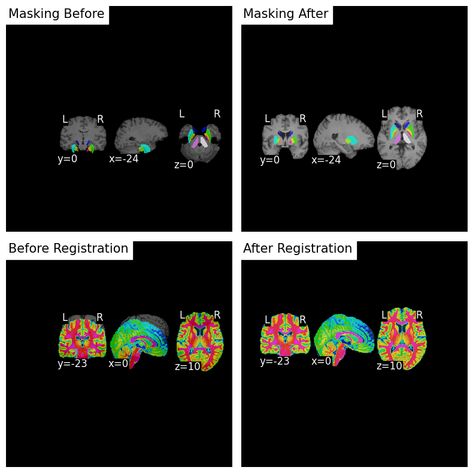
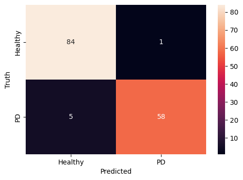
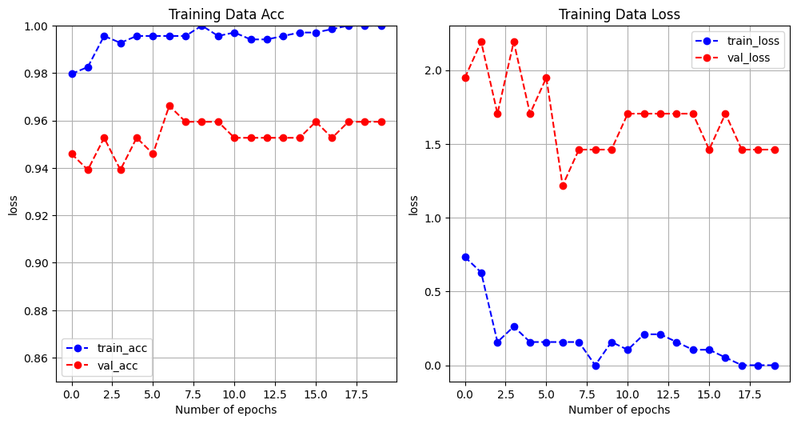
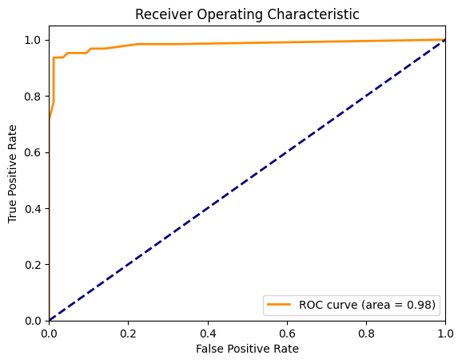
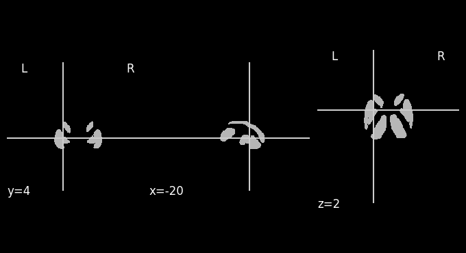

# Parkinson's Disease Detection from T1-Weighted MRI

A machine-learning pipeline that classifies **Parkinson's disease (PD)** patients versus **healthy controls** from 3D T1-weighted brain MRI. Scans are registered to the PD-specific **MNI PD25 atlas**, and radiomic features are extracted from the atlas's subcortical structures. A Random Forest is then trained on SVM-selected features. The trained model is also served through a small local **Flask** web app.

<p align="center">
  
</p>

## Problem and Motivation

Parkinson's disease is a progressive neurodegenerative disorder that affects about 1 % of people over 60. It's diagnosed mainly from clinical symptoms, which makes early and objective diagnosis hard. Structural MRI is widely available, and PD mostly affects deep (subcortical) brain structures such as the substantia nigra, putamen and caudate. This project tests whether **quantitative texture and intensity features from those structures** in routine T1-weighted MRI can tell PD patients from healthy subjects.

## Datasets

| Class | Dataset | Scans used | Source |
|---|---|---|---|
| Parkinson's disease | **PPMI**: Parkinson's Progression Markers Initiative (T1 MPRAGE, DICOM) | 488 (489 in the report) | [ppmi-info.org](https://www.ppmi-info.org/), access requires an approved data-use agreement |
| Healthy | **IXI**: T1-weighted scans of healthy subjects | 496 | [brain-development.org/ixi-dataset](https://brain-development.org/ixi-dataset/) |
| Atlas | **MNI PD25** multi-contrast PD atlas: T1 MPRAGE template and subcortical labels | — | [NIST / McGill PD25 atlas](https://nist.mni.mcgill.ca/multi-contrast-pd25-atlas/) |

The datasets aren't included in this repository. `sample_data/` holds a few registered example volumes for trying out the web app (see [Setup and Usage](#setup-and-usage)).

## Approach

1. **DICOM → NIfTI**: PPMI DICOM series are converted with `dcm2niix` (compressed output, BIDS sidecars).
2. **Registration**: each scan is non-linearly registered (ANTs **SyN**, via ANTsPy) to the PD25 T1 MPRAGE 1 mm template, so all subjects share one coordinate space (193 × 229 × 193 voxels).
3. **Region of interest**: the eight PD25 subcortical structures (caudate, putamen, GPi, GPe, thalamus, subthalamic nucleus, substantia nigra, red nucleus) are merged into a single **binary mask**.
4. **Radiomics**: **PyRadiomics** extracts first-order, GLCM, GLRLM, GLSZM, NGTDM and GLDM features inside the mask, giving one CSV per scan. After dropping metadata columns and constant columns (the shape features, which are identical because every subject shares the same mask), **93 features** remain.
5. **Exploration**: distributions, PCA projections, correlation and clustered heatmaps. Many features are strongly correlated.
6. **Modelling** (70/15/15 train/validation/test split, standardised features):
   - **Base model:** Random Forest on all 93 features.
   - **Gaussian Naive Bayes** baseline.
   - **Improved model:** `SelectFromModel` with an L2 **linear SVM** keeps 39 of the 93 features, followed by a 20-tree Random Forest.
7. **Deployment**: a Flask app extracts the same radiomic features from an uploaded NIfTI and predicts the class.

## Results

All numbers are taken from the recorded notebook outputs (test set: 148 scans, 85 healthy and 63 PD).

| Model | Features | Precision (macro) | Recall (macro) | F1 (macro) | Accuracy | ROC AUC |
|---|---|---|---|---|---|---|
| Random Forest (base) | 93 | 0.92 | 0.91 | 0.92 | 0.92 | 0.98 |
| Gaussian Naive Bayes | 93 | 0.61 | 0.59 | 0.53 | 0.55 | — |
| **Random Forest + SVM feature selection** | **39** | **0.96** | **0.95** | **0.96** | **0.96** | **0.98** |

Classification report of the improved model:

| Class | Precision | Recall | F1 | Support |
|---|---|---|---|---|
| Healthy | 0.94 | 0.99 | 0.97 | 85 |
| PD | 0.98 | 0.92 | 0.95 | 63 |

| Confusion matrix: base model | Confusion matrix: improved model |
|---|---|
|  |  |

| Training curves: improved model | ROC: improved model |
|---|---|
|  |  |

The training curves come from refitting the forest with 1 to 20 trees, one tree per "epoch".

An earlier experiment in the notebook, a Random Forest on a 90/10 split, reached 0.99 accuracy on 99 test scans. The report doesn't include it.

### Findings
- **Radiomic features** from atlas-defined subcortical regions separate the two groups well under this setup.
- **Removing redundant, highly correlated features** with a linear-SVM selector cut the input from 93 to 39 features and raised test accuracy from 0.92 to 0.96.
- **Gaussian Naive Bayes performs poorly** (0.55), which fits the strong correlation between features violating its independence assumption.

### Limitations
- **Dataset confound:** every healthy scan comes from IXI and every PD scan from PPMI, so the class is fully confounded with scanner, site and protocol. The classifier may partly learn dataset differences rather than disease effects.
- **Subject overlap:** the split is random by scan, not by subject. Judging by the PPMI file names, the PD scans come from about 217 subjects, 89 of whom have several scans, so the same person can appear in both the training and test sets.
- Neither effect was analysed in the project, and both may make the reported accuracy optimistic.

## Web App

<p align="center"></p>

`app/` holds the Flask application described in the report. It shows an upload form for a `.nii`/`.nii.gz` volume and then:
1. extracts PyRadiomics features inside the PD25 subcortical mask (`PD25-subcortical-1mm_bmask.nii.gz`);
2. applies the saved `StandardScaler`, the SVM feature selector and the Random Forest (`models/*.pkl`);
3. shows the predicted class (Healthy or Parkinson) and the middle axial slice of the uploaded volume.

The app **doesn't register images**. Uploaded volumes must already be in PD25 template space (193 × 229 × 193, 1 mm), like the files in `sample_data/`.

## Tech Stack

- **Language:** Python (the recorded Colab environment used Python 3.10)
- **Neuro-imaging:** dcm2niix, ANTsPy (`antspyx`), nibabel, nilearn, PyRadiomics (SimpleITK)
- **Machine learning:** scikit-learn (RandomForestClassifier, LinearSVC, SelectFromModel, GaussianNB), SciPy
- **Data and visualisation:** pandas, NumPy, Matplotlib, seaborn, natsort
- **Deployment:** Flask, HTML/CSS
- **Compute:** Google Colab with Google Drive storage

## Setup and Usage

```bash
git clone https://github.com/BasharatWali/Parkinson_Disease_Detection.git
cd Parkinson_Disease_Detection
pip install -r requirements.txt
```

**Notebook:** `jupyter notebook notebooks/Parkinson_Disease_Detection.ipynb`. The notebook is the original experiment log, and its paths point to Google Drive (`/content/drive/MyDrive/ML_proj/...`). Rerunning it needs:
- PPMI and IXI data,
- the PD25 atlas files (`PD25-T1MPRAGE-template-1mm.nii.gz`, `PD25-subcortical-1mm.nii.gz`),
- the `dcm2niix` system package (`sudo apt-get install dcm2niix`).

**Web app:**
```bash
cd app                 # the app loads models/ and the mask using paths relative to this folder
python Predictor.py    # starts Flask in debug mode on http://127.0.0.1:5000
```
Open the page, choose a registered NIfTI file (e.g. one from `sample_data/Healthy/`) and click **Predict**.

> The model files were pickled with **scikit-learn 1.2.2**. Loading them with a different version may produce warnings or errors, so `pip install scikit-learn==1.2.2` is the safest choice for the app. Only load pickle files you trust.

## Project Structure

```
Parkinson_Disease_Detection/
├── notebooks/
│   └── Parkinson_Disease_Detection.ipynb   # Conversion, registration, radiomics, EDA, models
├── app/                                    # Flask web app (unchanged from the original project)
│   ├── Predictor.py
│   ├── PD25-subcortical-1mm_bmask.nii.gz   # Binary subcortical ROI mask (PD25 space)
│   ├── models/                             # Pickled classifier, feature selector, scaler
│   ├── templates/index.html
│   └── static/Background.png
├── sample_data/                            # Example volumes already registered to PD25
│   ├── Healthy/                            # IXI subjects
│   └── PD/                                 # PPMI subject (git-ignored, see note below)
├── assets/                                 # Figures exported from the notebook outputs
├── requirements.txt
├── .gitignore
└── README.md
```

> `sample_data/PD/` is listed in `.gitignore`, because PPMI data is covered by a data-use agreement that generally doesn't allow redistribution.

## Notes on Report vs. Code

- The report gives 489 PD scans and a 689/148/148 split. The notebook data has 488 PD scans (984 in total) and a 688/148/148 split.
- The report's text gives a base-model test accuracy of 93 %. Its comparison table and the notebook output give 92 % (0.9189).
- The deployed model in `app/models/` (10 trees, 41 selected features) comes from a different training run than the 20-tree, 39-feature model recorded in the notebook. The notebook saves its models under different file names (`*_model2.pkl`).

## Author

**Basharat Ali**. Machine Learning course project (MS-AI, Fall 2023), Department of AI and Data Science, SEECS, National University of Sciences and Technology (NUST), Islamabad.

## References

1. K. Marek et al., "The Parkinson Progression Marker Initiative (PPMI)," *Progress in Neurobiology*, 95(4), 629–635, 2011.
2. IXI Dataset, https://brain-development.org/ixi-dataset/
3. B. B. Avants, N. Tustison and G. Song, "Advanced Normalization Tools (ANTS)," *Insight Journal*, 2009.
4. L. Collins, Multi-contrast PD25 atlas.
5. J. J. M. van Griethuysen et al., "Computational Radiomics System to Decode the Radiographic Phenotype," *Cancer Research*, 77(21), e104–e107, 2017.
6. F. Pedregosa et al., "Scikit-learn: Machine Learning in Python," *JMLR*, 12, 2825–2830, 2011.
